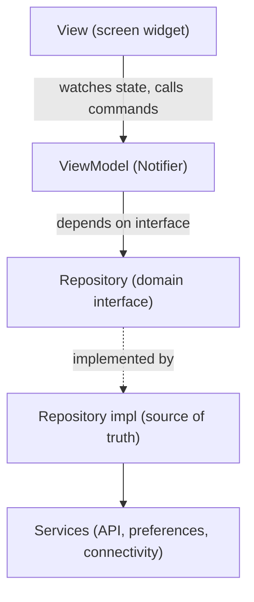

# Meal Finder

**Live demo: https://informramiz.github.io/flutter-showcase/** (web build of the same app, best viewed at phone width)

A recipe browser built with Flutter (stable 3.38, Dart 3) and Riverpod. It reads [TheMealDB](https://www.themealdb.com/api.php), a free public API with no sign-up, and keeps favourites on the device.

Built by Ramiz Raja as a small but complete example of production-style Flutter: code-generated providers, a typed API layer with sealed failures, MVVM layering, tests, strict lints and CI.

## Features

- Meal list with debounced search (350 ms) and category filter chips.
- Meal detail with image, category and area, ingredients with measures, and instructions.
- Favourites saved on device, toggled from the list or the detail screen.
- Loading, error with retry, empty and offline states. An offline banner follows connectivity.
- Light and dark theme following the system, with a toggle.

## Screenshots

Meals, detail, favourites and dark theme on each platform. iOS is the iOS 27 Simulator, Android is a Pixel phone, web is the demo build at 390px wide.

| Platform | Meals | Detail | Favourites | Dark |
| --- | --- | --- | --- | --- |
| iOS |  |  |  |  |
| Android |  |  |  |  |
| Web |  |  |  |  |

## Architecture

MVVM, per [Flutter's official architecture guide](https://docs.flutter.dev/app-architecture). The UI layer holds Views and ViewModels, the data layer holds Repositories and Services, and a small domain layer holds models and repository interfaces.



- **View**: a widget that watches one immutable freezed UI state and calls ViewModel commands. No business logic.
- **ViewModel**: `MealsViewModel`, `MealDetailViewModel`, `FavouritesViewModel`. Each is a Riverpod `Notifier` exposing a single freezed UI state (holding `AsyncValue`s) and commands such as `search`, `selectCategory`, `retry` and `toggleFavourite`.
- **Repository**: `MealRepository` and `FavouritesRepository` are interfaces in `domain/`. The implementations in `data/` return `Result<T>` and own caching and mapping. Favourites are a source of truth that emits a stream, so every screen updates together.
- **Service**: thin wrappers around one outside thing: `MealApiService` (Dio), `PreferencesService` (SharedPreferences), `ConnectivityService`.

### Folder map

```
lib/
  main.dart, app.dart, router.dart   Entry point, MaterialApp.router, go_router config
  core/
    result/         sealed Result<T> (Success / Err) and sealed AppFailure
    network/        FailureInterceptor (DioException -> AppFailure)
  domain/
    models/         Meal, Ingredient (freezed)
    repositories/   MealRepository, FavouritesRepository interfaces
  data/
    models/         MealDto (json_serializable) and mapping to domain
    services/       meal_api_service, preferences_service, connectivity_service
    repositories/   MealRepositoryImpl, FavouritesRepositoryImpl
  di/               providers.dart, the composition root
  ui/
    core/           strings, failure messages, theme, shared widgets (shell, state views, offline banner, MealCard)
    meals/          meals_screen, meals_view_model, meals_ui_state
    meal_detail/    meal_detail_screen, meal_detail_view_model, meal_detail_ui_state
    favourites/     favourites_screen, favourites_view_model, favourites_ui_state
test/               mirrors lib/: ViewModel unit tests, repository and service tests, widget and golden tests
tool/               coverage gate script
```

### Dependency injection

`lib/di/providers.dart` is the only place that wires concrete classes. Services and repositories are `keepAlive` Riverpod providers that return the interface type, and ViewModels read repositories through `ref`. `SharedPreferences` is overridden at startup, and tests override any provider with a fake.

### Navigation

go_router with a `StatefulShellRoute.indexedStack` for the Meals and Favourites tabs, so each tab keeps its state. The detail screen is the `/meal/:id` route, a real URL on web.

### Data flow

1. A View watches its ViewModel's UI state. Widgets never touch Dio.
2. The ViewModel calls the repository interface. The implementation calls a Service, and the Dio instance has a `FailureInterceptor`.
3. The interceptor maps every `DioException` to a sealed `AppFailure` (`NetworkFailure`, `ServerFailure`, `ParseFailure`, `NotFoundFailure`, `UnknownFailure`). Repositories return `Result<T>`, so errors are values, not surprise exceptions.
4. The ViewModel puts the result into `AsyncValue` inside its UI state, and screens `switch` over loading, data and error. `failure_message.dart` turns a failure into user text.
5. Search is debounced inside the ViewModel: it waits 350 ms and drops the call if the query changed meanwhile, so superseded requests never hit the network.
6. Favourites are written through to SharedPreferences by the repository, which emits the new list on a stream.

### Why each library

- **Riverpod + riverpod_generator**: compile-checked providers, `ref.watch` composition, and overrides that make tests trivial. `riverpod_lint` (through `custom_lint`) flags misuse such as `ref.read` in `build`.
- **go_router**: declarative routes, `StatefulShellRoute` keeps each tab's state, and `/meal/:id` is a real URL on web.
- **Dio**: interceptors for error mapping, timeouts, and a mockable adapter.
- **freezed + json_serializable**: immutable models with value equality and generated JSON.
- **shared_preferences**: see decisions below.
- **very_good_analysis**: strict lint set. `flutter analyze` reports zero issues.
- **mocktail**: mocks without codegen.

## Run

Requires Flutter 3.38 or newer on the stable channel. Generated files (`*.g.dart`, `*.freezed.dart`) are not committed.

```bash
flutter pub get
dart run build_runner build --delete-conflicting-outputs
flutter run                 # or: flutter run -d chrome
```

## Test

```bash
dart format --set-exit-if-changed lib test
flutter analyze
dart run custom_lint        # riverpod_lint rules
flutter test --coverage
tool/check_coverage.sh 80   # fails below 80% line coverage
flutter build web
```

72 tests, about 98% line coverage (generated files excluded by the script). The suite covers the `Result` type, failure mapping in the interceptor, the API service (against a stubbed Dio adapter), DTO to domain mapping including the flattened ingredient fields, the repository, ViewModel behaviour through `ProviderContainer` overrides (debounce, category filter, retry, favourites persistence, theme mode), widget tests for the list, detail and favourites screens (loading, error with retry, empty, not found, favourite toggle), and golden tests for the error view in light and dark.

Not covered: `main.dart` startup wiring, the connectivity plugin itself, and real network calls. Tests never hit TheMealDB.

## Web demo

`flutter build web --base-href /flutter-showcase/` builds the demo. `.github/workflows/pages.yml` deploys it to GitHub Pages, and `ci.yml` runs format, analyze, custom_lint, tests with the coverage gate, and a web build on every push and pull request. Limits on web:

- Pages has no SPA fallback, so the workflow copies `index.html` to `404.html`. A deep link such as `/meal/52772` works, but the server answers HTTP 404 before the app loads.
- Favourites use `localStorage` through SharedPreferences, so they are per browser.
- Images come from `themealdb.com`, which allows cross-origin loads.

## Decisions and trade-offs

- **shared_preferences, not drift.** The only local data is a short list of favourites (id, name, thumbnail, category) and one theme setting. That is key-value data. drift (SQLite) would add a schema, migrations and codegen with nothing to query. If favourites grew to need filtering, sorting or offline recipe caching, drift would be the next step, and only the favourites repository implementation would change.
- **API key `1`.** TheMealDB documents `1` as its public test key, so there is no secret to hide. For a commercial product you would use their paid key through a proxy.
- **Sealed `Result` and `AppFailure`.** Exhaustive `switch` over failures means adding a new failure type breaks the build until every screen handles it. `guard` converts only `AppFailure`, so programmer errors still crash loudly in tests.
- **`{"meals": null}` is not an error.** TheMealDB returns that for no results instead of a 404. The API layer maps it to an empty list for search and `NotFoundFailure` for lookup.
- **Flattened ingredients.** The API sends `strIngredient1..20` and `strMeasure1..20`. The DTO reads them into a list with `@JsonKey(readValue:)`, and blank pairs are dropped, so the domain model has `List<Ingredient>`.
- **Debounce in the provider, not the widget.** The text field only writes the query. Keeping timing in the provider makes it testable with fake time, with no widget pumping.
- **Retry off in tests.** Riverpod 3 retries failed providers by default. Tests and the app root set `retry: (_, _) => null` so the error state with a manual Retry button is what users and tests see.
- **Dependency versions are pinned below the newest.** The local toolchain is Flutter 3.38.7 (Dart 3.10), so packages are held to versions that resolve on it. CI uses the same Flutter version. Upgrading Flutter lets most of them move up.
- **Generated code is gitignored.** It keeps diffs small, and CI regenerates it with `build_runner`.
- **No i18n library and no custom accessibility work** beyond Flutter defaults. Strings are in `lib/ui/core/strings.dart`, so adding localisation later is mechanical.
- **No store release.** iOS and Android projects are scaffolded and build, but nothing is submitted.
