# Meal Finder

**Live demo: https://informramiz.github.io/flutter-showcase/** (web build of the same app, best viewed at phone width)

A recipe browser built with Flutter (stable 3.38, Dart 3) and Riverpod. It reads [TheMealDB](https://www.themealdb.com/api.php), a free public API with no sign-up, and keeps favourites on the device.

Built by Ramiz Raja as a complete example of production-style Flutter: MVVM with repositories, an offline-first drift database, a schema migration with tests, deep links, local notifications, localisation, strict lints and CI with a coverage gate.

## Features

- **Browse**: meal list with debounced search (350 ms) and category chips; meal detail with ingredients, measures and instructions. The list thumbnail flies into the detail image (Hero).
- **Offline-first**: everything you have seen is cached in SQLite (drift) and shown instantly, then revalidated in the background (stale-while-revalidate). A freshness bar says when data was updated, and offline search falls back to the local cache.
- **Weekly planner**: put meals into breakfast, lunch and dinner slots for the week, move or remove them.
- **Shopping list**: built from the week's plan, with ingredient measures parsed and summed (`200g` + `100g` = `300g`), checkable items.
- **Collections**: user-named groups of meals ("Weeknight", "Party"), added in schema v2 with a tested migration.
- **Cook reminders**: a weekly local notification an hour before a planned meal (Android and iOS). Tapping it opens the meal.
- **Deep links**: `mealfinder://open/meal/<id>` and `mealfinder://open/planner` on Android and iOS; the same paths are real URLs on web.
- **Favourites**, light and dark theme, English and Spanish (gen-l10n), loading, error with retry, empty and offline states.

## Screenshots

Meals, detail, favourites and dark theme on each platform (planner, shopping list, collections and reminders to be added). iOS is the iOS 27 Simulator, Android is a Pixel phone, web is the demo build at 390px wide.

| Platform | Meals | Detail | Favourites | Dark |
| --- | --- | --- | --- | --- |
| iOS | 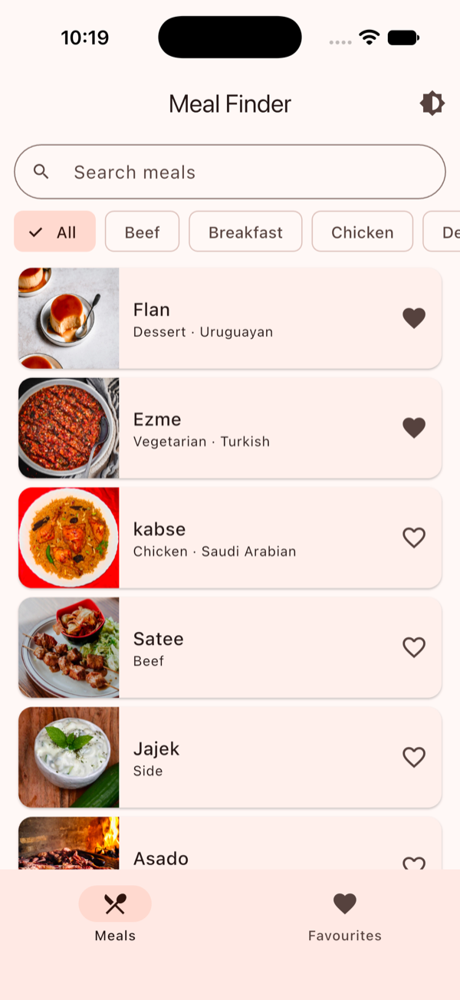 | 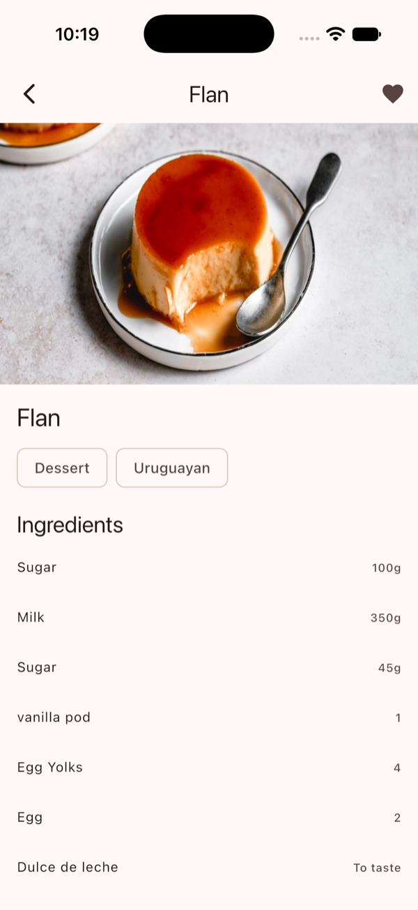 | 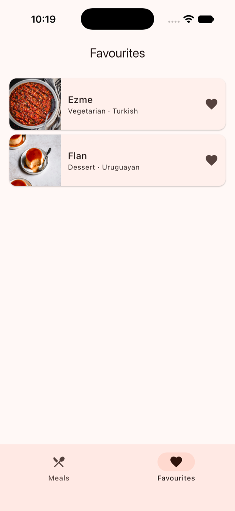 | 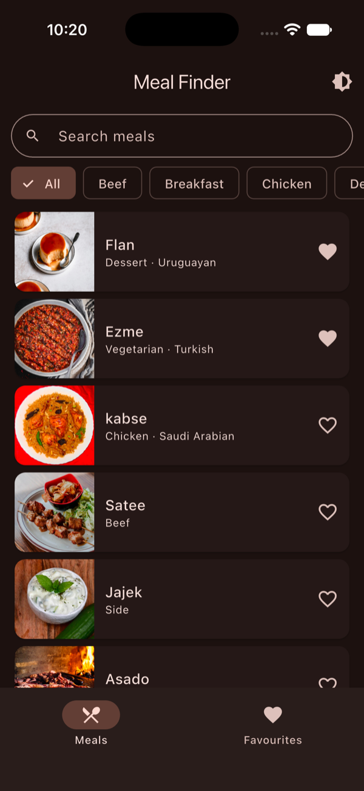 |
| Android | 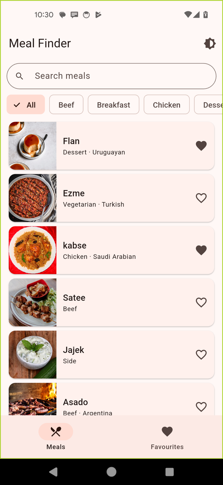 | 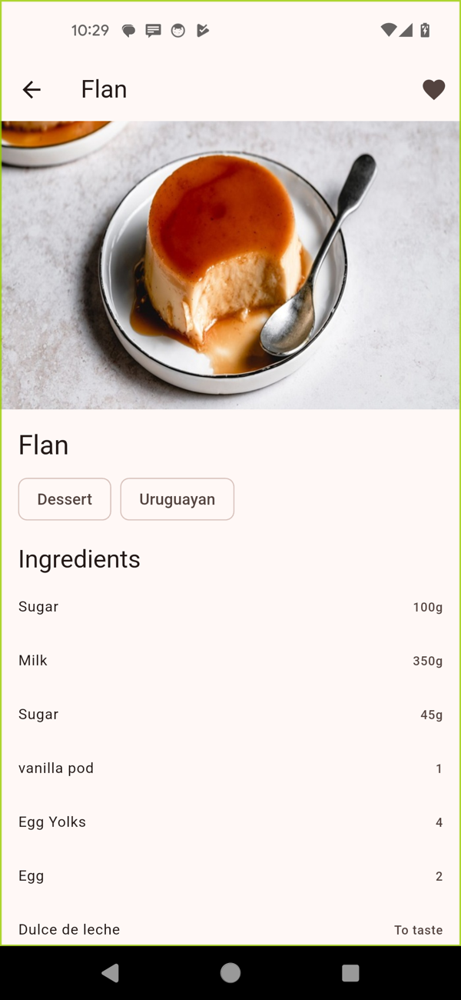 | 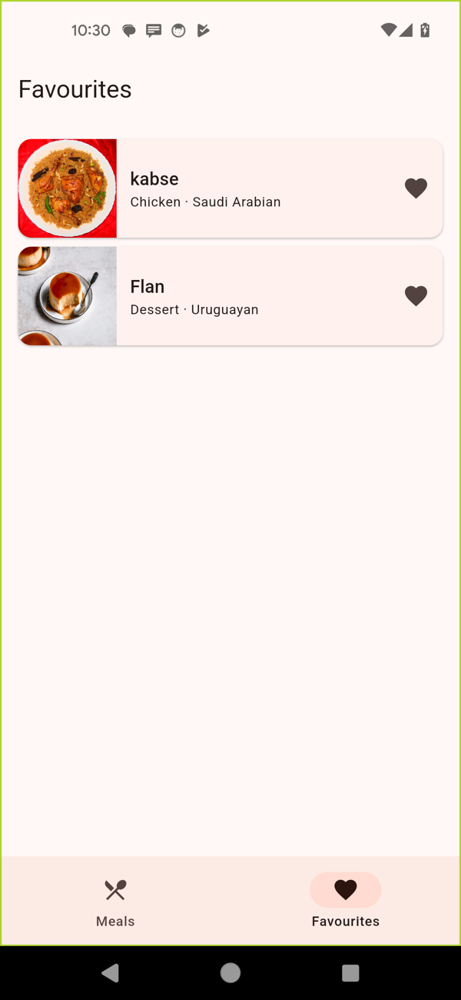 | 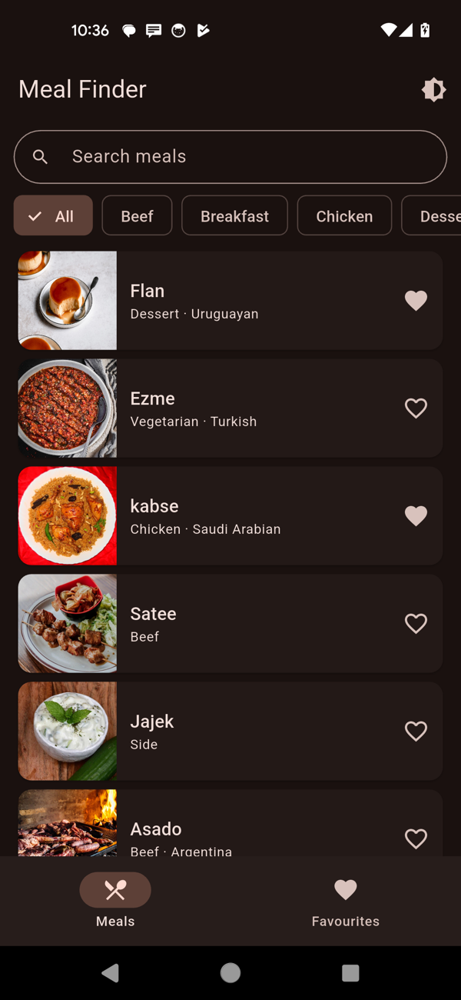 |
| Web | 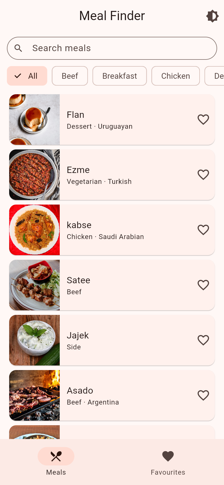 | 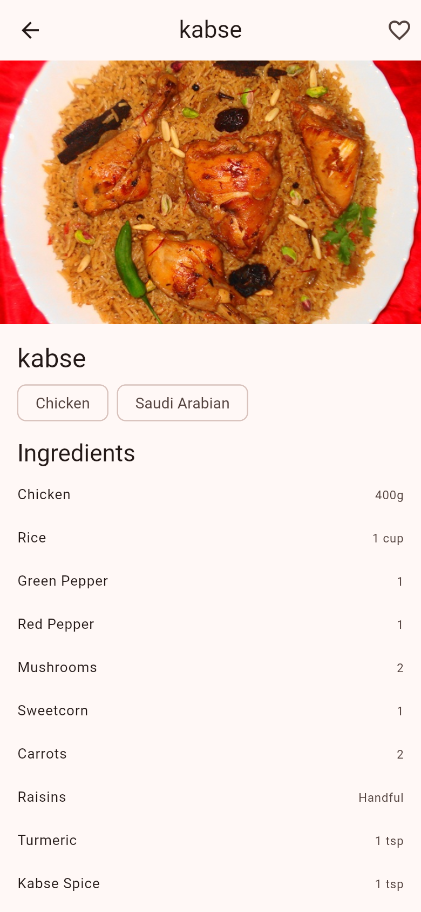 | 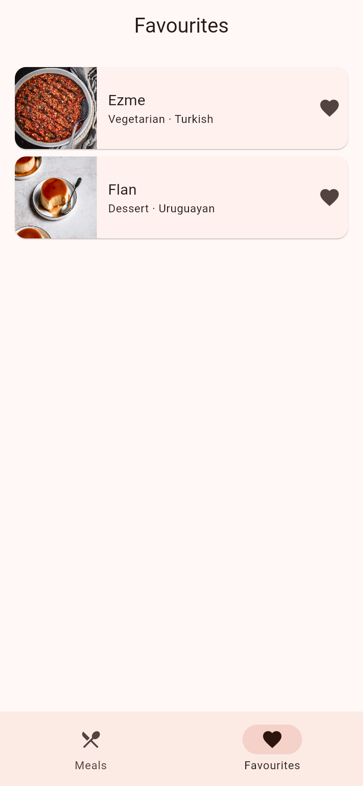 | 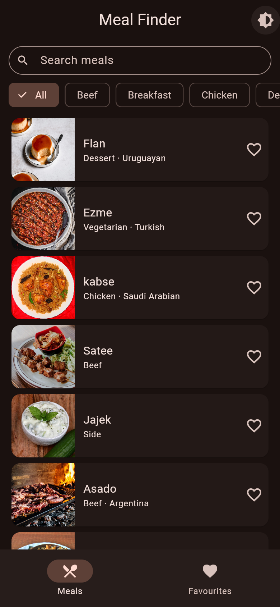 |

## Architecture

MVVM, per [Flutter's app architecture guide](https://docs.flutter.dev/app-architecture) and its [recommendations](https://docs.flutter.dev/app-architecture/recommendations). The UI layer holds Views and ViewModels, the data layer holds Repositories and Services, and a domain layer holds models, repository interfaces and pure logic.

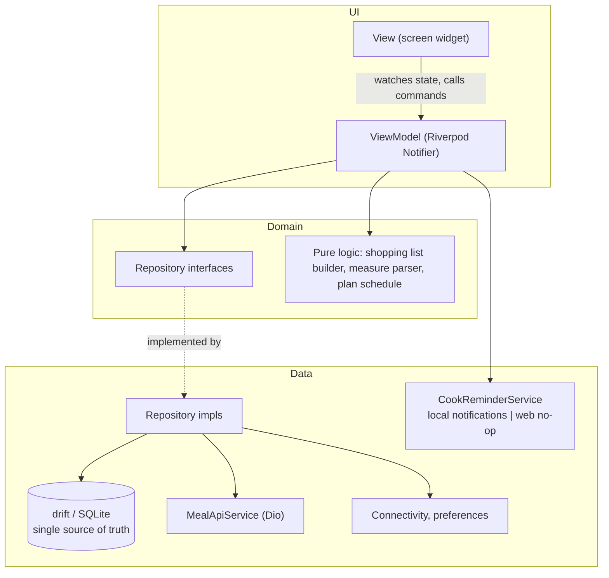

- **View**: watches one immutable freezed UI state and calls ViewModel commands. No business logic.
- **ViewModel**: a Riverpod `Notifier` per screen (`MealsViewModel`, `MealDetailViewModel`, `FavouritesViewModel`, `PlannerViewModel`, `ShoppingListViewModel`, `CollectionsViewModel`) exposing a single UI state and commands.
- **Repository**: interfaces in `domain/repositories`; implementations in `data/repositories` own the cache policy, mapping and writes, and expose `Stream`s so every screen updates together.
- **Service**: thin wrappers around one outside thing: `MealApiService` (Dio), `ConnectivityService`, `PreferencesService`, `CookReminderService`.
- **Domain logic** is plain Dart with no Flutter import: `ShoppingListBuilder`, `IngredientMeasureParser`, `nextCookReminder`, collection name rules.

### Offline-first flow

The database is the source of truth; the network only refreshes it ([Flutter offline-first guide](https://docs.flutter.dev/app-architecture/design-patterns/offline-first)). Every read goes through one `staleWhileRevalidate` helper:

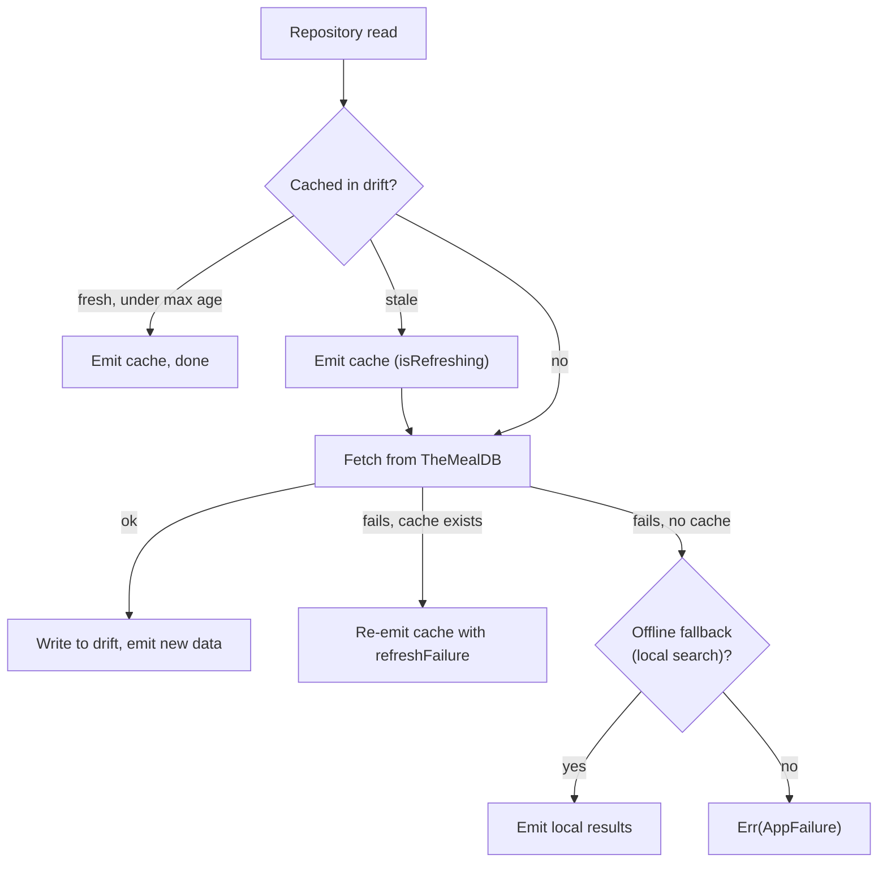

Max age is 1 hour for lists and 24 hours for a recipe. Pull to refresh forces a fetch. The UI shows the cache age and a quiet error when a refresh fails, instead of replacing good data with an error screen. Favourites, plans, shopping checks and collections are local-only tables.

### Database and migrations

drift with `drift_flutter` (native SQLite, and `sqlite3.wasm` plus a worker on web). Schema v1 holds the cache, favourites, plan and shopping tables; v2 adds `collections` and `collection_meals`. Following [drift's migration guide](https://drift.simonbinder.eu/migrations/), each version's schema is exported to `drift_schemas/`, `dart run drift_dev make-migrations` generates the `stepByStep` helper and test schemas, and `test/drift/app_database/migration_test.dart` upgrades a real v1 database to v2 and checks the schema and that existing rows survive. Favourites from the older shared_preferences version are imported once.

### Folder map

```
lib/
  main.dart, app.dart, router.dart   Entry point, MaterialApp.router, go_router config
  core/           Result/AppFailure, Dio FailureInterceptor, injectable Clock
  domain/
    models/         freezed models: Meal, Plan, ShoppingItem, MealCollection, Cached
    repositories/   repository interfaces
    services/       pure logic: shopping list builder, measure parser, plan schedule
  data/
    database/       drift database, tables, DAOs, generated migration steps
    models/         MealDto (json_serializable)
    repositories/   implementations and the stale-while-revalidate helper
    services/       API, connectivity, preferences, cook reminders
  di/             providers.dart, the composition root
  l10n/           app_en.arb, app_es.arb
  ui/             one folder per feature: screen, view model, UI state; core/ has shared widgets and theme
drift_schemas/    exported schema per version (input to migration tests)
test/             mirrors lib/; test/drift holds the migration test and generated schemas
tool/             coverage gate script
```

### Dependency injection

`lib/di/providers.dart` is the only place that wires concrete classes. Services and repositories are `keepAlive` Riverpod providers that return the interface type. The reminder provider picks `LocalCookReminderService` on mobile and `UnsupportedCookReminderService` on web. Tests override any provider with a fake or an in-memory database.

### Navigation and deep links

go_router with a `StatefulShellRoute.indexedStack`: Meals, Favourites, Planner and Collections tabs each keep their own stack. Meal detail is nested in every tab (`/meal/<id>`, `/favourites/meal/<id>`, ...), so it keeps the bottom bar and the Hero has a list and a detail route on the same navigator. Deep links use [Flutter's built-in deep linking](https://docs.flutter.dev/ui/navigation/deep-linking): an intent filter on Android and `CFBundleURLTypes` on iOS for the `mealfinder` scheme; go_router maps `mealfinder://open/meal/52772` to `/meal/52772`. A notification tap pushes the route it carries. Unknown links show a not-found page.

### Cook reminders

`CookReminderService` is an interface. On Android and iOS, `LocalCookReminderService` uses [flutter_local_notifications](https://pub.dev/packages/flutter_local_notifications) `zonedSchedule` with `DateTimeComponents.dayOfWeekAndTime`, so one notification repeats weekly in the device time zone (`timezone` + `flutter_timezone`). Permission is asked when the user turns a reminder on, not at launch. Android uses inexact scheduling, so no exact-alarm permission is needed, and a boot receiver restores reminders after a restart. Browsers cannot schedule notifications, so on web the service reports unsupported and the planner hides the option.

### Why each library

- **Riverpod + riverpod_generator**: compile-checked providers and overrides that make tests simple. `riverpod_lint` flags misuse.
- **drift**: typed SQL, reactive queries (`watch`), DAOs, and first-class migration tooling with generated test schemas. Runs on web through WASM.
- **go_router**: the router the Flutter team maintains; declarative routes, tab state, deep links and web URLs.
- **Dio**: interceptors for error mapping, timeouts and a mockable adapter.
- **freezed + json_serializable**: immutable models with value equality and generated JSON.
- **flutter_local_notifications + timezone**: the standard plugin for scheduled local notifications.
- **very_good_analysis**: strict lint set. `flutter analyze` reports zero issues.
- **mocktail**: mocks without codegen, used only at plugin boundaries; ViewModel tests use hand-written fakes.

## Run

Requires Flutter 3.38 or newer on the stable channel. Generated files (`*.g.dart`, `*.freezed.dart`) are not committed; drift's migration steps and schema files are.

```bash
flutter pub get
flutter gen-l10n
dart run build_runner build --delete-conflicting-outputs --force-jit
flutter run                 # or: flutter run -d chrome
```

## Test

```bash
dart format --set-exit-if-changed lib test
flutter analyze
dart run custom_lint        # riverpod_lint rules
flutter test --coverage --exclude-tags golden
tool/check_coverage.sh 80   # fails below 80% line coverage
flutter test --tags golden  # golden images
dart run drift_dev make-migrations   # after a schema change
flutter build web
```

226 tests, about 97% line coverage (generated code excluded by the script).

- **Domain**: shopping list building and measure arithmetic, plan scheduling, reminder times, collection name rules.
- **Data**: the API service against a stubbed Dio adapter, DTO mapping, the stale-while-revalidate paths, every repository and DAO against an in-memory drift database, the reminder service against a mocked plugin.
- **Migration**: `migration_test.dart` upgrades v1 to v2 and verifies schema and data.
- **ViewModels**: through `ProviderContainer` with fake repositories and a fake clock (debounce, filters, planner moves, reminders on, off and denied, collections).
- **Widgets**: every screen's loading, error, empty and data states, the save-to-collection sheet, deep links (sent as platform route messages), notification taps, the Hero flight, and golden tests for the error view in light and dark.

Not covered: `main.dart` startup wiring, the plugins themselves on a device, and real network calls. Tests never hit TheMealDB.

## Web demo

`flutter build web --base-href /flutter-showcase/` builds the demo. `.github/workflows/pages.yml` deploys it to GitHub Pages, and `ci.yml` runs format, analyze, custom_lint, tests with the coverage gate, and a web build on every push and pull request. Limits on web:

- Pages has no SPA fallback, so the workflow copies `index.html` to `404.html`. A deep link such as `/meal/52772` works, but the server answers HTTP 404 before the app loads.
- The database is SQLite in the browser (WASM, stored in OPFS or IndexedDB), so data is per browser.
- Cook reminders are hidden: browsers have no API for scheduled notifications.
- Images come from `themealdb.com`, which allows cross-origin loads.

## Decisions and trade-offs

- **drift as the single source of truth.** The app now caches recipes, plans weeks and groups meals, which is relational data that needs queries, joins and migrations. Screens read only from the database; the network only refreshes it. shared_preferences is kept just for the theme setting.
- **Stale-while-revalidate over cache-then-network.** Showing a fresh-enough cache with no request saves data and battery; a stale cache is still shown at once. Max ages are constants in one place.
- **API key `1`.** TheMealDB documents `1` as its public test key, so there is no secret to hide. For a commercial product you would use their paid key through a proxy.
- **Sealed `Result` and `AppFailure`.** Exhaustive `switch` over failures means adding a new failure type breaks the build until every screen handles it. `guard` converts only `AppFailure`, so programmer errors still crash loudly in tests.
- **`{"meals": null}` is not an error.** TheMealDB returns that for no results instead of a 404. The API layer maps it to an empty list for search and `NotFoundFailure` for lookup.
- **Flattened ingredients.** The API sends `strIngredient1..20` and `strMeasure1..20`. The DTO reads them into a list with `@JsonKey(readValue:)`, and blank pairs are dropped, so the domain model has `List<Ingredient>`.
- **Debounce in the provider, not the widget.** The text field only writes the query. Keeping timing in the provider makes it testable with fake time, with no widget pumping.
- **Retry off in tests.** Riverpod 3 retries failed providers by default. Tests and the app root set `retry: (_, _) => null` so the error state with a manual Retry button is what users and tests see.
- **Dependency versions are pinned below the newest.** The local toolchain is Flutter 3.38.7 (Dart 3.10), so packages are held to versions that resolve on it. CI uses the same Flutter version. Upgrading Flutter lets most of them move up.
- **Generated code is gitignored.** It keeps diffs small, and CI regenerates it with `build_runner`.
- **Reminders behind an interface.** The planner depends on `CookReminderService`, not the plugin, so web gets a no-op, tests get a fake, and the plugin code has its own unit tests.
- **Inexact weekly alarms.** A cook reminder does not need second precision, and exact alarms need an extra Android permission that Play restricts.
- **Custom URL scheme, not App Links / Universal Links.** Verified https links need a hosted `assetlinks.json` and `apple-app-site-association` on a domain; the scheme shows the same routing without one.
- **No custom accessibility work** beyond Flutter defaults.
- **No store release.** iOS and Android projects are scaffolded and build, but nothing is submitted.
